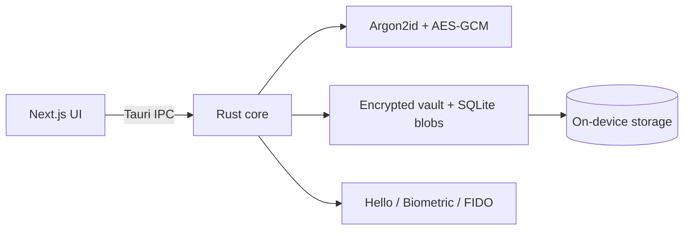

<p align="center">
  
</p>

<h1 align="center">🔐 GenVault</h1>

---

<p align="center">
  <strong>The Ultimate Offline Password &amp; TOTP Security Vault</strong><br />
  Modern, Fast, and Secure Authentication for Windows &amp; Android
</p>

---

<p align="center">
  
  
  
  
  
</p>

<p align="center">
  🚀 <a href="#-quick-start-developers">Quick Start</a>
  &nbsp;•&nbsp;
  📦 <a href="#-download">Download</a>
  &nbsp;•&nbsp;
  🔒 <a href="#-security">Security</a>
  &nbsp;•&nbsp;
  📖 <a href="#-overview">About</a>
</p>

---

## 🎯 Overview

**GenVault** is an offline-first password and TOTP vault by **GenXis Innovations**.  
Your credentials and 2FA secrets stay **on your device** — encrypted with **AES-256-GCM**, unlocked with your master password (plus biometrics when you choose).

Built with **Tauri 2**, **Rust**, and **Next.js** for a fast desktop shell on Windows and a Material You experience on Android. No Cognito. No mandatory cloud sync. No server that can read your vault.

| You get | You avoid |
|---------|-----------|
| Encrypted vault on device | Cloud-held plaintext |
| TOTP / HOTP codes | Shipping seeds to a third party |
| Biometrics + password | Biometrics as the only factor |
| Microsoft Store install | Browser-only toy vaults |

---

## 📦 Download

<p align="center">
  <a href="https://apps.microsoft.com/detail/9P8PJDTP506T?hl=en-us&gl=IN&ocid=pdpshare">
    
  </a>
</p>

| Platform | Status | Action |
|----------|--------|--------|
| **Windows** | Available now | [Download on Microsoft Store](https://apps.microsoft.com/detail/9P8PJDTP506T?hl=en-us&gl=IN&ocid=pdpshare) |
| **Android** | Release soon | Google Play — coming soon |

Tester / CI builds: [GitHub Releases](https://github.com/lalupj07/Gen-Vault/releases) (binaries are not stored in git).

---

## ✨ Features

- **Password & TOTP vault** — accounts, secrets, notes, tags, favorites  
- **Strong unlock** — master password, PIN, Windows Hello / Android biometrics, optional security key  
- **Secure clipboard** — timed clear for OTP and secrets  
- **Encrypted backup / USB export** — passphrase-wrapped portable backups  
- **Recovery codes** — one-time offline recovery  
- **QR enroll** — scan TOTP provisioning QR on Android  
- **Material You mobile UI** — glass shell, fonts, languages, in-app back stack  
- **Privacy-minded** — screenshot / FLAG_SECURE protections where the OS allows  

---

## 🔒 Security

| Layer | Detail |
|-------|--------|
| Cipher | AES-256-GCM |
| KDF | Argon2id (`m=19456`, `t=3`, `p=4`) |
| OTP | HMAC-SHA-1 TOTP / HOTP |
| Session | In-memory VMK, zeroized on lock |
| IPC | Sensitive commands require unlocked session |
| Notes | Omitted from list DTOs; master-password step-up to reveal |
| Android | Keystore-backed protector + BiometricPrompt on unlock consent |

Full details: **[SECURITY.md](./SECURITY.md)** · Privacy: **[store/PRIVACY_POLICY.md](./store/PRIVACY_POLICY.md)**



---

## 🚀 Quick Start (developers)

**Prerequisites:** Node.js 20+, Rust (stable), Android SDK / JDK 21 for mobile.

```bash
npm install
npm run tauri:dev
```

Android:

```bash
npm run tauri:android:dev
```

Release builds:

```bash
npm run build:release          # Windows
npm run tauri:android:build    # Android
```

More: [BUILD_QUICK_START.md](./BUILD_QUICK_START.md) · [BUILD_RELEASE.md](./BUILD_RELEASE.md) · [DEPLOYMENT.md](./DEPLOYMENT.md) · [CONTRIBUTING.md](./CONTRIBUTING.md)

### Repository layout

```text
src/                 React / Next.js UI (desktop + mobile shell)
src-tauri/           Rust crypto, vault, Tauri + Android glue
store/               Listing copy, privacy, terms, MSIX assets
scripts/             Windows / MSIX build helpers
.github/workflows/   CI (build + security scan)
```

---

## 🌐 Links & Resources

<p align="center">
  <a href="https://github.com/lalupj07/Gen-Vault/releases"></a>
  <a href="https://github.com/lalupj07/Gen-Vault/issues"></a>
  <a href="https://github.com/lalupj07/Gen-Vault/issues/new"></a>
</p>

<p align="center">
  <a href="./store/PRIVACY_POLICY.md"></a>
  <a href="./CHANGELOG.md"></a>
  <a href="https://apps.microsoft.com/detail/9P8PJDTP506T?hl=en-us&gl=IN&ocid=pdpshare"></a>
  
</p>

---

## ⭐ Show Your Support

<p align="center">
  If you find <strong>GenVault</strong> useful, please consider giving it a ⭐ on GitHub!<br />
  Your support helps us improve GenVault for everyone.
</p>

<p align="center">
  <a href="https://github.com/lalupj07/Gen-Vault"></a>
  <a href="https://github.com/lalupj07/Gen-Vault/fork"></a>
</p>

---

## 🏢 About GenXis Innovations

<p align="center">
  Empowering people with modern, secure, offline-first software.<br />
  Kottayam, Kerala, India
</p>

<p align="center">
  <a href="https://www.genxisinnovation.in">www.genxisinnovation.in</a>
  &nbsp;·&nbsp;
  <a href="mailto:genxisinnovation@outlook.com">genxisinnovation@outlook.com</a>
</p>

---

<p align="center">
  🎉 Made with ❤️ by <a href="https://www.genxisinnovation.in">GenXis Innovations</a>
</p>

<p align="center">
  <sub>GenVault · Windows on Microsoft Store · Android Play release soon · MIT License</sub>
</p>
