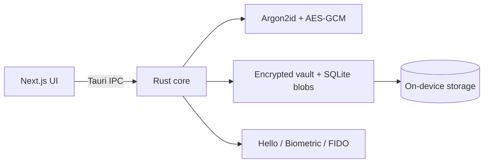

<p align="center">
  
</p>

<h1 align="center">GenVault</h1>

<p align="center">
  <strong>The offline password &amp; TOTP vault</strong><br />
  by <a href="https://genxis.in">GenXis Innovations</a>
</p>

<p align="center">
  <a href="#download"></a>
  
</p>

<p align="center">
  <a href="./SECURITY.md"></a>
  <a href="./LICENSE"></a>
  
  
  
  
  
  
  
  
</p>

<p align="center">
  Master-password gated · AES-256-GCM at rest · Argon2id KDF · No cloud required
</p>

---

## Download

<p align="center">
  <a href="https://apps.microsoft.com/detail/9P8PJDTP506T?hl=en-us&gl=IN&ocid=pdpshare">
    
  </a>
  &nbsp;&nbsp;
  
</p>

| Platform | Status | Get it |
|----------|--------|--------|
| **Windows** | Available | [Download on Microsoft Store](https://apps.microsoft.com/detail/9P8PJDTP506T?hl=en-us&gl=IN&ocid=pdpshare) |
| **Android** | Release soon | Google Play — coming soon |

Sideload / CI builds stay on [GitHub Releases](https://github.com/lalupj07/Gen-Vault/releases) for testers — store builds are the recommended install path.

---

## Why GenVault

GenVault keeps **credentials and 2FA secrets on your device**. Unlock locally, copy codes securely, lock when you leave. No mandatory cloud sync — and no server that can read your vault.

| You get | You avoid |
|---------|-----------|
| Encrypted vault on device | Cloud-held plaintext or sync side-channels |
| TOTP / HOTP codes | Shipping seeds to a third party |
| Biometrics + password | Biometrics as the only factor |
| Windows + Android | Browser-only toy vaults |

## Features

- **Password & TOTP vault** — accounts, secrets, notes, tags, favorites
- **Strong unlock** — master password, PIN, Windows Hello / Android biometrics, optional security key
- **Secure clipboard** — timed clear for OTP and secrets
- **Encrypted backup / USB export** — passphrase-wrapped portable backups
- **Recovery codes** — one-time offline recovery
- **QR enroll** — scan TOTP provisioning QR on Android
- **Material You mobile UI** — glass shell, fonts, languages, in-app back stack
- **Privacy-minded** — screenshot / FLAG_SECURE protections where the OS allows

## Security (short)

| Layer | Detail |
|-------|--------|
| Cipher | AES-256-GCM |
| KDF | Argon2id (`m=19456`, `t=3`, `p=4`) |
| OTP | HMAC-SHA-1 TOTP / HOTP |
| Session | In-memory VMK, zeroized on lock |
| IPC | Sensitive commands require unlocked session |
| Notes | Omitted from list DTOs; master-password step-up to reveal |
| Android | Keystore-backed protector + BiometricPrompt on unlock consent |

Full write-up: **[SECURITY.md](./SECURITY.md)** · Store privacy: **[store/PRIVACY_POLICY.md](./store/PRIVACY_POLICY.md)**

## Architecture



## Quick start (developers)

### Prerequisites

- Node.js 20+
- Rust (stable) + Cargo
- For Android: Android SDK / JDK 21 (see `BUILD_RELEASE.md`)

### Develop

```bash
npm install
npm run tauri:dev
```

Android:

```bash
npm run tauri:android:dev
```

### Release builds

```bash
npm run build:release          # Windows bundles
npm run tauri:android:build    # Android APK / AAB
```

Installers and APKs are **gitignored**. Attach them to [GitHub Releases](https://github.com/lalupj07/Gen-Vault/releases) — do not commit binaries.

More: [BUILD_QUICK_START.md](./BUILD_QUICK_START.md) · [BUILD_RELEASE.md](./BUILD_RELEASE.md) · [DEPLOYMENT.md](./DEPLOYMENT.md)

## Repository layout

```text
src/                 React / Next.js UI (desktop + mobile shell)
src-tauri/           Rust crypto, vault, Tauri + Android glue
store/               Listing copy, privacy, terms, MSIX assets
scripts/             Windows / MSIX build helpers
.github/workflows/   CI (build + security scan)
```

## Configuration

No cloud secrets are required. Optional local overrides: copy [`.env.example`](./.env.example) → `.env.local` (never commit).

## Contributing

See **[CONTRIBUTING.md](./CONTRIBUTING.md)**. Keep security first — never commit `.env`, keystores, or vault data.

## License

[MIT](./LICENSE) © GenXis Innovations

---

<p align="center">
  <br /><br />
  <strong>GenVault</strong> — your secrets stay on your device.<br />
  <a href="https://apps.microsoft.com/detail/9P8PJDTP506T?hl=en-us&gl=IN&ocid=pdpshare">Microsoft Store</a>
  · Google Play (soon)
  · <a href="https://genxis.in">genxis.in</a>
  · <a href="./SECURITY.md">Security</a>
  · <a href="./CHANGELOG.md">Changelog</a>
</p>

<p align="center">
  <sub>Built offline-first by GenXis Innovations · Windows available now · Android Play release soon</sub>
</p>
